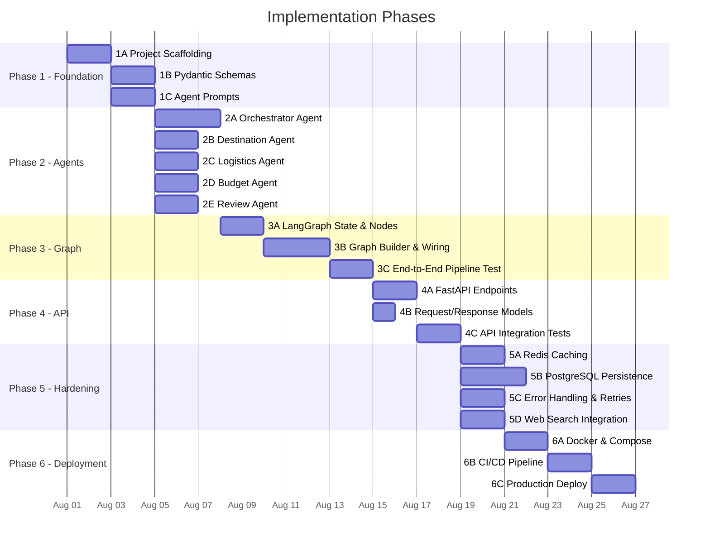
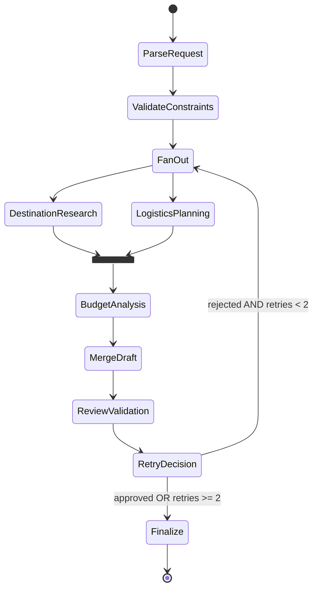
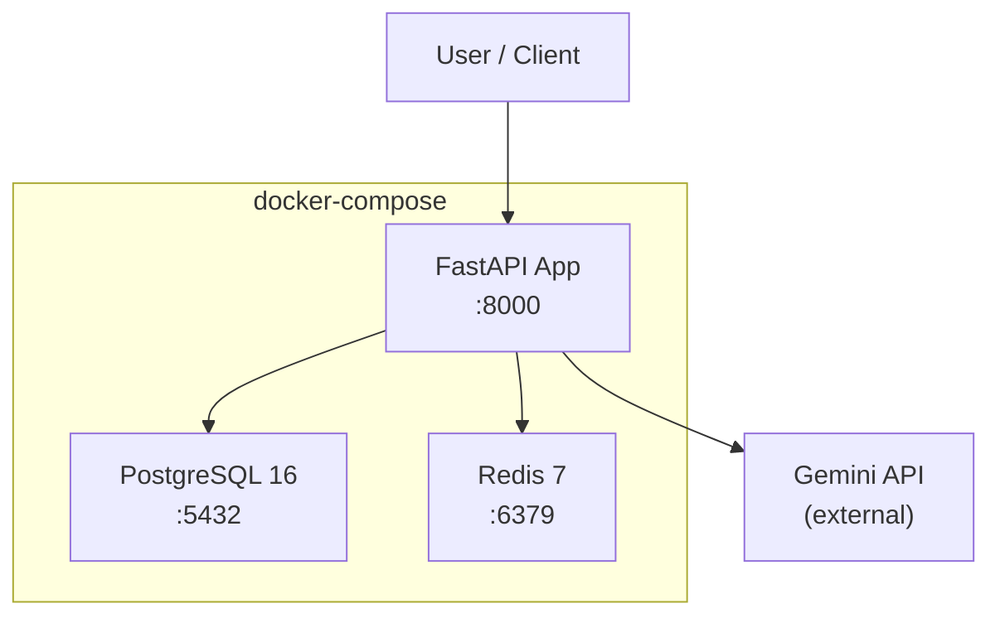

# Implementation Plan — Dubai AI Travel Planner

> **References:**
> - [problemstatement.md](file:///c:/Users/tanis/projects/Multi%20agentic%20next%20leap/docs/problemstatement.md)
> - [architecture.md](file:///c:/Users/tanis/projects/Multi%20agentic%20next%20leap/docs/architecture.md)
>
> **Scope:** Dubai only (v1) · Python 3.12+ · LangGraph · Gemini · FastAPI

---

## Phase Overview



---

## Phase 1 — Foundation & Scaffolding

> **Goal:** Set up the project structure, dependency management, configuration, and all Pydantic schemas so that every subsequent phase has a stable base to build on.

---

### Step 1A · Project Scaffolding

Create the full directory structure and install core dependencies.

#### Tasks

| #   | Task | Files | Details |
|-----|------|-------|---------|
| 1A.1 | Create directory tree | All `src/`, `tests/`, `docs/` dirs | Match the structure defined in [architecture.md §6](file:///c:/Users/tanis/projects/Multi%20agentic%20next%20leap/docs/architecture.md#L357-L423) |
| 1A.2 | Initialize `pyproject.toml` | `pyproject.toml` | Project metadata, Python 3.12+ requirement, all dependencies |
| 1A.3 | Create `.env.example` | `.env.example` | Template with all required env vars (API keys, DB URL, Redis) |
| 1A.4 | Create `.gitignore` | `.gitignore` | Standard Python gitignore + `.env`, `__pycache__`, `.venv` |
| 1A.5 | Create `src/config.py` | `src/config.py` | `Settings` class via `pydantic-settings` per [architecture.md §7](file:///c:/Users/tanis/projects/Multi%20agentic%20next%20leap/docs/architecture.md#L427-L466) |
| 1A.6 | Create `README.md` | `README.md` | Project overview, setup instructions, usage |
| 1A.7 | Set up virtual env & install deps | Terminal | `python -m venv .venv && pip install -e ".[dev]"` |

#### Dependencies (`pyproject.toml`)

```toml
[project]
name = "dubai-travel-planner"
version = "0.1.0"
requires-python = ">=3.12"
dependencies = [
    "fastapi>=0.115",
    "uvicorn[standard]>=0.30",
    "pydantic>=2.8",
    "pydantic-settings>=2.4",
    "langgraph>=0.2",
    "langchain-google-genai>=2.0",
    "litellm>=1.40",
    "structlog>=24.4",
    "httpx>=0.27",
]

[project.optional-dependencies]
dev = [
    "pytest>=8.3",
    "pytest-asyncio>=0.24",
    "ruff>=0.6",
    "mypy>=1.11",
]
db = [
    "sqlalchemy[asyncio]>=2.0",
    "asyncpg>=0.29",
    "redis>=5.0",
]
tools = [
    "tavily-python>=0.5",
]
```

#### Exit Criteria
- [ ] `pip install -e ".[dev]"` succeeds with no errors
- [ ] `python -c "from src.config import Settings; print(Settings())"` loads with defaults
- [ ] All `__init__.py` files exist in every package directory

---

### Step 1B · Pydantic Schemas

Define all typed data models used across agents. These are the **contracts** that every agent reads and writes.

#### Tasks

| #   | Task | File | Schema Classes |
|-----|------|------|----------------|
| 1B.1 | Request schemas | `src/schemas/request.py` | `TravelRequest`, `PlanAPIRequest` |
| 1B.2 | Destination schemas | `src/schemas/destination.py` | `Recommendation`, `DestinationOutput` |
| 1B.3 | Logistics schemas | `src/schemas/logistics.py` | `Accommodation`, `DaySchedule`, `LogisticsOutput` |
| 1B.4 | Budget schemas | `src/schemas/budget.py` | `BudgetBreakdown`, `BudgetAlert`, `BudgetOutput` |
| 1B.5 | Review schemas | `src/schemas/review.py` | `ReviewResult` |
| 1B.6 | Response schemas | `src/schemas/response.py` | `PlanResponse`, `DayDetail`, `ActivityDetail` |
| 1B.7 | Package exports | `src/schemas/__init__.py` | Re-export all public models |

All schemas should exactly match the definitions in [architecture.md §3](file:///c:/Users/tanis/projects/Multi%20agentic%20next%20leap/docs/architecture.md#L50-L227).

#### Key Schema: `TravelRequest`

```python
class TravelRequest(BaseModel):
    destination: str             # "Dubai"
    duration_days: int           # 5
    budget_usd: float            # 3000.0
    preferences: list[str]       # ["food", "architecture"]
    avoidances: list[str]        # ["crowds"]
    traveler_count: int = 1
    raw_input: str               # Original user text
```

#### Exit Criteria
- [ ] All schema files created with full Pydantic v2 models
- [ ] `mypy src/schemas/` passes with no errors
- [ ] Schemas can be instantiated with sample data in a test

---

### Step 1C · Agent System Prompts

Write the system prompt for each agent as a plain `.txt` file. These prompts are Dubai-specific and will include local knowledge.

#### Tasks

| #   | Task | File | Key Content |
|-----|------|------|-------------|
| 1C.1 | Orchestrator prompt | `src/prompts/orchestrator.txt` | Role definition, constraint extraction format, synthesis instructions |
| 1C.2 | Destination prompt | `src/prompts/destination.txt` | Dubai neighborhoods (Deira, Bur Dubai, Downtown, JBR, Palm Jumeirah, Business Bay), landmarks, food districts, crowd patterns |
| 1C.3 | Logistics prompt | `src/prompts/logistics.txt` | Dubai Metro map, taxi fare estimates, inter-area travel times, hotel tier pricing |
| 1C.4 | Budget prompt | `src/prompts/budget.txt` | USD-to-AED conversion (1 USD ≈ 3.67 AED), cost ranges based on [Wikivoyage Dubai Budget](https://en.wikivoyage.org/wiki/Dubai#Budget) |
| 1C.5 | Review prompt | `src/prompts/review.txt` | 6-point validation checklist, scoring rubric, approval/rejection criteria |

#### Prompt Design Principles
- Include Dubai-specific factual context directly in each prompt (neighborhoods, cost ranges, transit options)
- Enforce JSON/structured output format in every prompt
- Keep temperature low (0.2–0.3) for consistency
- Include examples of expected output format

#### Exit Criteria
- [ ] All 5 prompt files created in `src/prompts/`
- [ ] Each prompt includes a clear role, input format, output format, and Dubai-specific context
- [ ] Prompts reference the Pydantic schema field names to ensure structured output alignment

---

## Phase 2 — Agent Implementation

> **Goal:** Implement each of the 5 agents as standalone Python modules. Each agent takes typed input, calls the LLM with its system prompt, and returns typed output. No graph wiring yet — agents are tested in isolation.

---

### Step 2A · Orchestrator Agent

The central coordinator that parses user requests and synthesizes final output.

#### File: `src/agents/orchestrator.py`

| #   | Task | Details |
|-----|------|---------|
| 2A.1 | `parse_request()` function | Takes raw user text → calls LLM → returns `TravelRequest` |
| 2A.2 | `merge_draft()` function | Takes `DestinationOutput` + `LogisticsOutput` + `BudgetOutput` → produces a `DraftItinerary` |
| 2A.3 | `finalize_plan()` function | Takes `DraftItinerary` + `ReviewResult` → produces `FinalItinerary` (or triggers retry) |
| 2A.4 | LLM integration via LiteLLM | Use `groq/llama-3.3-70b-versatile` model, structured output with Pydantic |
| 2A.5 | Unit tests | `tests/test_orchestrator.py` — test parsing with sample inputs, test merge logic |

#### Key Design Notes
- Uses `groq/llama-3.3-70b-versatile` (needs strong reasoning for parsing & synthesis)
- The parse step should handle edge cases: missing budget, ambiguous destinations, multiple cities
- The merge step is primarily a formatting/combination task — can be deterministic Python code supplemented by one LLM call for narrative generation

---

### Step 2B · Destination Research Agent

#### File: `src/agents/destination.py`

| #   | Task | Details |
|-----|------|---------|
| 2B.1 | `research_destinations()` function | Takes `TravelRequest` → calls LLM → returns `DestinationOutput` |
| 2B.2 | Dubai-specific knowledge | Prompt includes: Al Fahidi, Dubai Frame, Burj Khalifa, Deira Spice Souk, JBR Walk, Museum of the Future, etc. |
| 2B.3 | Crowd-level tagging | Each recommendation tagged with `low`/`medium`/`high` crowd level |
| 2B.4 | Priority classification | Items classified as `must-do` or `nice-to-have` based on user preferences |
| 2B.5 | Unit tests | `tests/test_destination.py` — validate output schema, check preference alignment |

#### Key Design Notes
- Uses `groq/llama-3.3-70b-versatile` (speed-optimized, large output)
- v1 is LLM-only; no web search integration yet (that's Phase 5)
- Output should include 10–15 recommendations covering the user's preference categories

---

### Step 2C · Logistics Agent

#### File: `src/agents/logistics.py`

| #   | Task | Details |
|-----|------|---------|
| 2C.1 | `plan_logistics()` function | Takes `TravelRequest` + `DestinationOutput` → returns `LogisticsOutput` |
| 2C.2 | Accommodation selection | Suggest areas + hotel tiers based on budget and proximity to attractions |
| 2C.3 | Day-by-day scheduling | Produce `DaySchedule` for each day with activities, transport, and time blocks |
| 2C.4 | Transport recommendations | Dubai Metro, taxis, walking — with estimated times |
| 2C.5 | Unit tests | `tests/test_logistics.py` — validate day count matches duration, check transport realism |

#### Key Design Notes
- Uses `groq/llama-3.3-70b-versatile`
- Reads `DestinationOutput` from shared state to organize recommendations into daily plans
- Should minimize backtracking by clustering nearby attractions on the same day

---

### Step 2D · Budget Agent

#### File: `src/agents/budget.py`

| #   | Task | Details |
|-----|------|---------|
| 2D.1 | `analyze_budget()` function | Takes `TravelRequest` + `DestinationOutput` + `LogisticsOutput` → returns `BudgetOutput` |
| 2D.2 | Cost aggregation | Sum up hotel, food, transport, and activity costs from upstream outputs |
| 2D.3 | Category breakdown | Split into Stay / Transport / Food / Activities / Miscellaneous |
| 2D.4 | Over-budget detection | Flag when total > budget; suggest specific cheaper alternatives |
| 2D.5 | Currency awareness | Internally use AED cost data, present output in USD |
| 2D.6 | Unit tests | `tests/test_budget.py` — verify budget math, test over-budget alerting |

#### Key Design Notes
- Uses `groq/llama-3.3-70b-versatile`
- This agent runs **after** Destination and Logistics (dependency on their output for cost data)
- Should include a 10% miscellaneous buffer in cost estimates

---

### Step 2E · Review Agent

#### File: `src/agents/review.py`

| #   | Task | Details |
|-----|------|---------|
| 2E.1 | `review_itinerary()` function | Takes `DraftItinerary` + `TravelRequest` → returns `ReviewResult` |
| 2E.2 | 6-point validation | Duration ✓, Destination ✓, Budget ✓, Preferences ✓, Avoidances ✓, Realism ✓ |
| 2E.3 | Scoring | Produce `overall_score` (0.0–1.0) based on checklist pass rate |
| 2E.4 | Actionable feedback | If rejected: specific `issues` + `suggestions` for the Orchestrator |
| 2E.5 | Unit tests | `tests/test_review.py` — test approval/rejection paths with sample itineraries |

#### Key Design Notes
- Uses `gemini-2.5-flash` (fast execution for validation, limit 5 RPM)
- Approval threshold: `overall_score >= 0.7`
- If rejected, the Orchestrator re-dispatches with the Review Agent's feedback (max 2 retries)

---

### Phase 2 Exit Criteria
- [ ] All 5 agent modules implemented and importable
- [ ] Each agent can be called independently with mock/sample input and returns valid Pydantic output
- [ ] Unit tests pass for all agents: `pytest tests/test_*.py`
- [ ] LLM calls are working end-to-end with real GROQ and Gemini API keys

---

## Phase 3 — LangGraph Pipeline

> **Goal:** Wire all agents together using LangGraph. Build the state machine that handles fan-out, fan-in, review loops, and retry logic.

---

### Step 3A · Shared State & Node Functions

#### Files: `src/graph/state.py`, `src/graph/nodes.py`

| #   | Task | File | Details |
|-----|------|------|---------|
| 3A.1 | Define `PlannerState` | `src/graph/state.py` | TypedDict with all shared fields: `travel_request`, `destination_output`, `logistics_output`, `budget_output`, `draft_itinerary`, `review_result`, `final_itinerary`, `retry_count`, `errors` |
| 3A.2 | `parse_request_node()` | `src/graph/nodes.py` | Wraps `orchestrator.parse_request()`, writes to state |
| 3A.3 | `destination_node()` | `src/graph/nodes.py` | Wraps `destination.research_destinations()`, reads/writes state |
| 3A.4 | `logistics_node()` | `src/graph/nodes.py` | Wraps `logistics.plan_logistics()`, reads/writes state |
| 3A.5 | `budget_node()` | `src/graph/nodes.py` | Wraps `budget.analyze_budget()`, reads/writes state |
| 3A.6 | `merge_node()` | `src/graph/nodes.py` | Wraps `orchestrator.merge_draft()`, reads/writes state |
| 3A.7 | `review_node()` | `src/graph/nodes.py` | Wraps `review.review_itinerary()`, reads/writes state |
| 3A.8 | `finalize_node()` | `src/graph/nodes.py` | Wraps `orchestrator.finalize_plan()`, reads/writes state |
| 3A.9 | `retry_decision()` | `src/graph/nodes.py` | Conditional edge: if review rejected AND retries < 2 → re-dispatch; else → finalize |

#### State Definition

```python
from typing import TypedDict, Optional
from src.schemas import *

class PlannerState(TypedDict):
    raw_input: str
    travel_request: Optional[TravelRequest]
    destination_output: Optional[DestinationOutput]
    logistics_output: Optional[LogisticsOutput]
    budget_output: Optional[BudgetOutput]
    draft_itinerary: Optional[dict]
    review_result: Optional[ReviewResult]
    final_itinerary: Optional[dict]
    retry_count: int
    errors: list[str]
```

---

### Step 3B · Graph Builder & Wiring

#### File: `src/graph/builder.py`

| #   | Task | Details |
|-----|------|---------|
| 3B.1 | Create `StateGraph` | Initialize with `PlannerState` |
| 3B.2 | Add nodes | All 8 node functions from 3A |
| 3B.3 | Wire sequential edges | `parse_request → fan_out_start` |
| 3B.4 | Wire parallel fan-out | `fan_out_start → [destination_node, logistics_node]` (in parallel) |
| 3B.5 | Wire fan-in + budget | `[destination_node, logistics_node] → budget_node` |
| 3B.6 | Wire merge & review | `budget_node → merge_node → review_node → retry_decision` |
| 3B.7 | Wire conditional retry | `retry_decision → fan_out_start` (if rejected) OR `retry_decision → finalize_node` (if approved) |
| 3B.8 | Set entry/exit points | Entry = `parse_request`, Exit = `finalize_node` |
| 3B.9 | Compile graph | `graph.compile()` |
| 3B.10 | Export `build_planner_graph()` function | Returns compiled graph |

#### Execution Flow Diagram



> **Important:** Destination and Logistics run in parallel. Budget runs after both complete (it needs their outputs). This is a semi-parallel graph, not fully parallel across all three.

---

### Step 3C · End-to-End Pipeline Test

#### File: `tests/test_graph.py`

| #   | Task | Details |
|-----|------|---------|
| 3C.1 | Happy path test | Full pipeline with a standard Dubai travel request → approved itinerary |
| 3C.2 | Retry path test | Mock Review Agent to reject on first try → verify retry + re-approval |
| 3C.3 | Max retries test | Mock Review Agent to always reject → verify pipeline exits after 2 retries |
| 3C.4 | Error handling test | Mock one agent to raise an exception → verify graceful degradation |
| 3C.5 | State integrity test | Verify all state fields are populated correctly after each node |

#### Exit Criteria
- [ ] `pytest tests/test_graph.py` passes all 5 test cases
- [ ] Full pipeline completes in < 2 minutes with real LLM calls
- [ ] State object contains valid data at every stage
- [ ] Retry loop triggers correctly on Review rejection

---

## Phase 4 — API Layer

> **Goal:** Expose the LangGraph pipeline through a FastAPI REST API with proper request/response models and error handling.

---

### Step 4A · FastAPI Application & Routes

#### Files: `src/main.py`, `src/api/routes.py`, `src/api/dependencies.py`

| #   | Task | File | Details |
|-----|------|------|---------|
| 4A.1 | Create FastAPI app | `src/main.py` | App initialization, CORS middleware, lifespan events, router registration |
| 4A.2 | Health endpoint | `src/api/routes.py` | `GET /api/v1/health` → returns system status |
| 4A.3 | Plan endpoint | `src/api/routes.py` | `POST /api/v1/plan` → accepts `PlanAPIRequest`, runs graph, returns `PlanResponse` |
| 4A.4 | Get plan endpoint | `src/api/routes.py` | `GET /api/v1/plan/{plan_id}` → retrieves a stored plan (in-memory dict for v1) |
| 4A.5 | Dependency injection | `src/api/dependencies.py` | `get_settings()`, `get_graph()` factories |
| 4A.6 | Error handlers | `src/main.py` | Global exception handlers for `ValidationError`, `TimeoutError`, LLM failures |

#### API Request/Response Models

```python
# Request
class PlanAPIRequest(BaseModel):
    query: str            # "Plan a 5-day trip to Dubai..."
    traveler_count: int = 1

# Response
class PlanResponse(BaseModel):
    plan_id: str
    status: Literal["completed", "failed", "partial"]
    itinerary: Optional[dict]     # Full nested itinerary
    budget_summary: Optional[BudgetOutput]
    review: Optional[ReviewResult]
    errors: list[str] = []
    processing_time_seconds: float
```

---

### Step 4B · Request / Response Model Refinement

| #   | Task | Details |
|-----|------|---------|
| 4B.1 | Create `ActivityDetail` model | Nested model for each activity with time, cost, category, crowd level |
| 4B.2 | Create `DayDetail` model | Day number, theme, list of activities, transport, daily cost |
| 4B.3 | Create `ItineraryResponse` model | Full itinerary wrapper with days, accommodations, budget breakdown |
| 4B.4 | Add OpenAPI metadata | Tags, descriptions, examples for auto-generated Swagger docs |

---

### Step 4C · API Integration Tests

#### File: `tests/test_api.py`

| #   | Task | Details |
|-----|------|---------|
| 4C.1 | Test health endpoint | `GET /api/v1/health` returns 200 |
| 4C.2 | Test plan creation | `POST /api/v1/plan` with valid input returns 200 + itinerary |
| 4C.3 | Test invalid input | `POST /api/v1/plan` with empty query returns 422 |
| 4C.4 | Test plan retrieval | `GET /api/v1/plan/{id}` returns stored plan |
| 4C.5 | Test timeout handling | Mock slow LLM → verify timeout response |

#### Exit Criteria
- [ ] `uvicorn src.main:app --reload` starts successfully
- [ ] Swagger docs available at `http://localhost:8000/docs`
- [ ] `POST /api/v1/plan` returns a complete Dubai itinerary
- [ ] `pytest tests/test_api.py` passes all tests

---

## Phase 5 — Hardening & Enhancements

> **Goal:** Add production-grade features: caching, persistence, error resilience, and optional web search.

---

### Step 5A · Redis Caching

#### Files: `src/config.py` (update), new cache utility

| #   | Task | Details |
|-----|------|---------|
| 5A.1 | Add Redis dependency | `redis[hiredis]` to `pyproject.toml` |
| 5A.2 | Create cache utility | `src/tools/cache.py` — `get_cached()`, `set_cached()` functions |
| 5A.3 | Cache key strategy | `hash(agent_name + json.dumps(input, sort_keys=True))` |
| 5A.4 | TTL configuration | 24-hour default, configurable in `Settings` |
| 5A.5 | Integrate into agent nodes | Wrap each LLM call: check cache → hit? return cached → miss? call LLM → store result |
| 5A.6 | Fresh bypass | Support `?fresh=true` query param to skip cache |

---

### Step 5B · PostgreSQL Persistence

#### Files: `src/db/models.py`, `src/db/session.py`

| #   | Task | Details |
|-----|------|---------|
| 5B.1 | Define ORM models | `Plan` table: id, query, status, itinerary (JSONB), created_at, processing_time |
| 5B.2 | Create session factory | Async SQLAlchemy session with connection pooling |
| 5B.3 | Integrate into API routes | Save plan after completion, load on `GET /api/v1/plan/{id}` |
| 5B.4 | Add Alembic for migrations | `alembic init`, create initial migration |
| 5B.5 | Update `GET /api/v1/plan/{id}` | Query from PostgreSQL instead of in-memory dict |

---

### Step 5C · Error Handling & Retries

| #   | Task | Details |
|-----|------|---------|
| 5C.1 | LLM retry logic | Exponential backoff: 1s → 2s → 4s, max 3 retries via LiteLLM config |
| 5C.2 | Provider fallback | If Gemini fails after retries → switch to OpenAI GPT-4o automatically |
| 5C.3 | Schema re-prompting | If LLM output fails Pydantic validation → re-prompt with the error message |
| 5C.4 | Timeout enforcement | 60s per agent, 5 min for full pipeline |
| 5C.5 | Graceful degradation | If one agent fails → continue with partial data, mark response as `"partial"` |
| 5C.6 | Structured logging | Add `structlog` with `plan_id` correlation, JSON output |

---

### Step 5D · Web Search Integration (Optional)

#### File: `src/tools/search.py`

| #   | Task | Details |
|-----|------|---------|
| 5D.1 | Tavily search wrapper | `search_dubai_info(query: str) → list[SearchResult]` |
| 5D.2 | Integrate into Destination Agent | Optionally call web search for real-time data (opening hours, events, reviews) |
| 5D.3 | Result filtering | Filter search results by relevance score; limit to top 5 |
| 5D.4 | Fallback behavior | If search fails or is unconfigured → fall back to LLM-only mode |

#### Exit Criteria
- [ ] Cached requests return in < 1 second
- [ ] Plans persist across server restarts (PostgreSQL)
- [ ] LLM failures trigger retries → fallback → graceful error (not a crash)
- [ ] Structured logs include `plan_id` for request tracing

---

## Phase 6 — Containerization & Deployment

> **Goal:** Package the application for local development and production deployment.

---

### Step 6A · Docker & Docker Compose

| #   | Task | File | Details |
|-----|------|------|---------|
| 6A.1 | Create Dockerfile | `Dockerfile` | Multi-stage build: Python 3.12 slim, install deps, copy source, run uvicorn |
| 6A.2 | Create Docker Compose | `docker-compose.yml` | 3 services: `app` (FastAPI), `postgres` (PostgreSQL 16), `redis` (Redis 7) |
| 6A.3 | Health checks | `docker-compose.yml` | Health check endpoints for all 3 services |
| 6A.4 | Volume mounts | `docker-compose.yml` | Source code mount for hot-reload in dev, named volume for PostgreSQL data |
| 6A.5 | Environment file | `docker-compose.yml` | Load from `.env` |

#### Docker Compose Architecture



---

### Step 6B · CI/CD Pipeline

#### File: `.github/workflows/ci.yml`

| #   | Task | Details |
|-----|------|---------|
| 6B.1 | Lint job | Run `ruff check src/ tests/` |
| 6B.2 | Type check job | Run `mypy src/` |
| 6B.3 | Unit test job | Run `pytest tests/ -v --tb=short` (mock LLM calls) |
| 6B.4 | Build job | Build Docker image, verify it starts |
| 6B.5 | Trigger rules | Run on push to `main` and on all PRs |

---

### Step 6C · Production Deployment

| #   | Task | Details |
|-----|------|---------|
| 6C.1 | Choose platform | Railway or Google Cloud Run |
| 6C.2 | Provision managed PostgreSQL | Railway Postgres or Cloud SQL |
| 6C.3 | Provision managed Redis | Railway Redis or Memorystore |
| 6C.4 | Set environment variables | All API keys, DB URL, Redis URL in platform secrets |
| 6C.5 | Deploy & smoke test | Verify `POST /api/v1/plan` works end-to-end in production |

#### Exit Criteria
- [ ] `docker compose up` starts all 3 services successfully
- [ ] CI pipeline passes on GitHub Actions
- [ ] Production endpoint responds to `POST /api/v1/plan` with a valid itinerary
- [ ] End-to-end latency < 90 seconds for a standard request

---

## Appendix A — File Tracker

Complete mapping of every file to its creation phase.

| Phase | File | Purpose |
|-------|------|---------|
| 1A | `pyproject.toml` | Project metadata & dependencies |
| 1A | `.env.example` | Environment variable template |
| 1A | `.gitignore` | Git ignore rules |
| 1A | `README.md` | Project documentation |
| 1A | `src/__init__.py` | Package init |
| 1A | `src/config.py` | Settings management |
| 1B | `src/schemas/__init__.py` | Schema package |
| 1B | `src/schemas/request.py` | Request models |
| 1B | `src/schemas/destination.py` | Destination output models |
| 1B | `src/schemas/logistics.py` | Logistics output models |
| 1B | `src/schemas/budget.py` | Budget output models |
| 1B | `src/schemas/review.py` | Review result model |
| 1B | `src/schemas/response.py` | API response models |
| 1C | `src/prompts/orchestrator.txt` | Orchestrator system prompt |
| 1C | `src/prompts/destination.txt` | Destination Agent system prompt |
| 1C | `src/prompts/logistics.txt` | Logistics Agent system prompt |
| 1C | `src/prompts/budget.txt` | Budget Agent system prompt |
| 1C | `src/prompts/review.txt` | Review Agent system prompt |
| 2A | `src/agents/__init__.py` | Agents package |
| 2A | `src/agents/orchestrator.py` | Orchestrator Agent |
| 2B | `src/agents/destination.py` | Destination Research Agent |
| 2C | `src/agents/logistics.py` | Logistics Agent |
| 2D | `src/agents/budget.py` | Budget Agent |
| 2E | `src/agents/review.py` | Review Agent |
| 3A | `src/graph/__init__.py` | Graph package |
| 3A | `src/graph/state.py` | Shared state definition |
| 3A | `src/graph/nodes.py` | Node wrapper functions |
| 3B | `src/graph/builder.py` | Graph construction & compilation |
| 4A | `src/main.py` | FastAPI application |
| 4A | `src/api/__init__.py` | API package |
| 4A | `src/api/routes.py` | Route definitions |
| 4A | `src/api/dependencies.py` | Dependency injection |
| 5A | `src/tools/cache.py` | Redis caching utility |
| 5B | `src/db/__init__.py` | Database package |
| 5B | `src/db/models.py` | SQLAlchemy ORM models |
| 5B | `src/db/session.py` | Session management |
| 5D | `src/tools/search.py` | Web search integration |
| 6A | `Dockerfile` | Container image |
| 6A | `docker-compose.yml` | Local dev stack |
| 6B | `.github/workflows/ci.yml` | CI/CD pipeline |

---

## Appendix B — Risk Register

| Risk | Impact | Likelihood | Mitigation |
|------|--------|------------|------------|
| LLM output doesn't match Pydantic schema | Agents fail to parse | Medium | Schema re-prompting with validation errors; few-shot examples in prompts |
| Gemini API rate limits hit | Pipeline stalls | Medium | LiteLLM retry + fallback to OpenAI; Redis caching reduces repeat calls |
| Pipeline too slow (> 2 min) | Poor UX | Medium | Parallel fan-out; Flash models for 3/5 agents; caching |
| Dubai-specific knowledge outdated | Inaccurate recommendations | Low | Web search integration in Phase 5; regular prompt updates |
| Review Agent always rejects | Infinite loop | Low | Hard cap at 2 retries; accept with warnings after max retries |
| Prompt injection via user input | Security risk | Low | Input sanitization before prompt injection; separate user text from instructions |

---

## Appendix C — Success Metrics

| Metric | Target | Measurement |
|--------|--------|-------------|
| End-to-end latency | < 90 seconds | Timer from request to response |
| Review approval rate (first pass) | > 70% | `review_result.approved == True` on first try |
| Budget accuracy | Within 15% of real-world costs | Manual spot-check of generated cost estimates |
| User satisfaction | > 4/5 star rating | Feedback endpoint data |
| Pipeline success rate | > 95% | Successful completions / total requests |
| Test coverage | > 80% | `pytest --cov` report |
